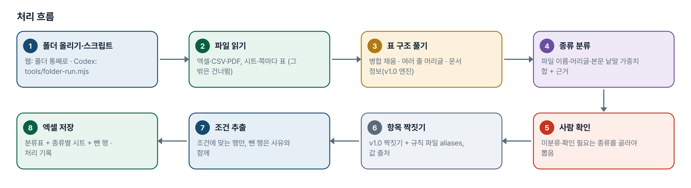
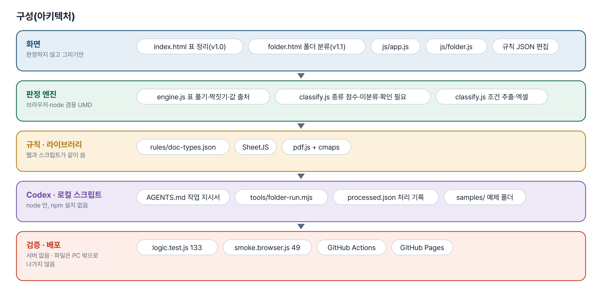
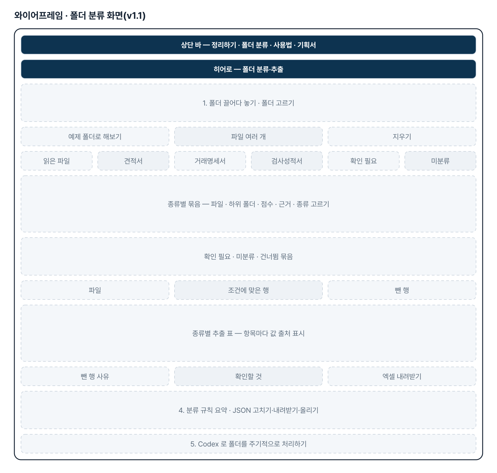
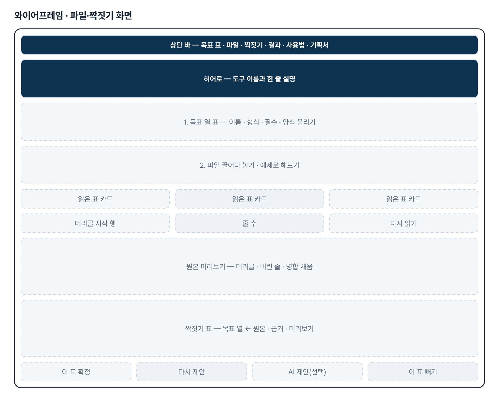
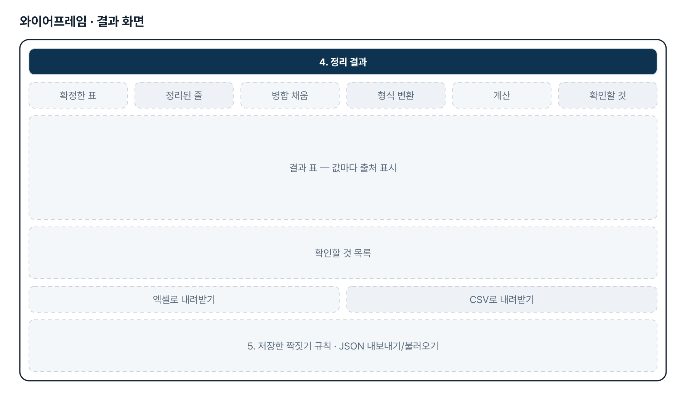
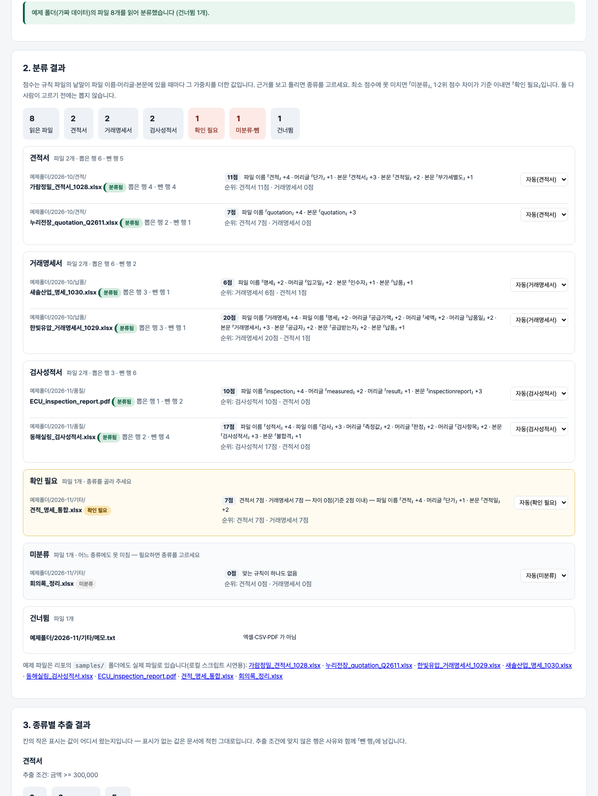

# 엑셀·PDF 문서 정리 — 프로젝트 기획서 v1.1

- 기획: Wang Jeon · 작성일 2026-11-03 · 생성형 AI 업무자동화 전문가과정 · 2차수 프로젝트 02
- 바로 쓰기: https://build-2611-02.jobability.co.kr/
- 워드 판: `docs/기획서/build-2611-02_WangJeon_엑셀PDF문서정리_기획서_v1.1.docx`

## 개요

양식이 제각각인 엑셀·PDF 표를 정해 둔 최종 표 구조(목표 열)로 짝지어 제안하고, 사람이 확인·확정한 표만 엑셀·CSV로 정리해 주는 도구입니다. v1.1부터는 폴더를 통째로 올리면 문서 종류별로 나누고 조건에 맞는 데이터만 뽑아 엑셀로 저장하며, 같은 규칙으로 Codex가 로컬 스크립트를 돌릴 수 있습니다.

### 배경 · 현재 업무
- 엑셀·PDF 문서의 내용을 추출해 데이터베이스에 등록하는 업무를 파이썬 등으로 자동화하려 했으나 원하는 결과가 잘 저장되지 않았습니다.
- 정리된 최종 결과 표 구조는 정해져 있지만, 받는 파일마다 데이터 형태와 열 이름이 표준화되어 있지 않습니다.
- 엑셀 시트가 여러 개이거나 셀 병합·여러 줄 머리글이 있으면 그대로 읽어서는 값이 비거나 어긋납니다.
- 완전 자동보다 AI·규칙이 길을 제안하고 사람이 판단해 빠르게 정리하는 방식이 먼저 필요합니다.
- (v1.1 추가 요청) Codex를 쓰고 있으며, 특정 폴더에 쌓이는 문서를 자동 분류하고 조건에 맞는 데이터를 자동 추출·저장한 뒤, 분류된 문서와 결과를 웹페이지에서 보고 싶습니다.

### 목표
- 최종 표 구조(목표 열)를 화면이나 양식 엑셀로 한 번 정합니다.
- 여러 시트·병합 셀·두 줄 머리글·PDF 표를 풀어 읽습니다.
- 원본 열을 목표 열에 짝지어 근거와 함께 제안하고, 사람이 고쳐 확정합니다.
- 값마다 출처(문서 값·병합 채움·변환·계산 등)를 남겨 엑셀·CSV로 내보냅니다.
- 확정한 짝짓기를 규칙으로 저장해 같은 양식의 다음 파일에 그대로 씁니다.
- (v1.1) 폴더 안 엑셀·PDF를 규칙(파일 이름·머리글·본문 낱말)으로 문서 종류별로 나누고, 근거와 함께 보여 줍니다.
- (v1.1) 종류마다 정한 항목 중 추출 조건에 맞는 행만 뽑아 엑셀로 저장하고, Codex가 같은 규칙으로 폴더를 주기 처리하게 합니다.

## 요구사항과 구현

| 기획서 요구 | 구현 |
|---|---|
| 정리된 최종 결과 표 구조는 정해져 있음 | 목표 열(이름·형식·필수)을 화면에서 정의하거나 양식 엑셀로 올림 |
| 형태·컬럼명이 표준화되어 있지 않음 | 열 이름 유사도(같은 뜻 낱말 표·포함·글자 비슷함) + 값 모양으로 짝 제안, 신뢰 높음/보통/낮음 |
| AI 가 어느 정도 가이드 제공 | 선택: OpenAI·Anthropic 키로 열 이름+예시 값 3개만 보내 짝 제안 — 「AI 초안 — 검토 필요」 |
| 사람이 판단하여 빠르게 정리 | 짝마다 고르는 칸·근거·미리보기, 표별 확정, 제안대로 모두 확정 |
| Sheet 가 여러 개 · 셀 병합 | 시트마다 표 하나, 병합 범위 값 채움(「병합 채움」 표시), 병합 머리글을 여러 줄 머리글로 합침 |
| 다양한 원하는 데이터 추출 | 머리글 위 「항목 : 값」을 문서 정보로 뽑아 열처럼 짝지음, 시트·파일 이름·직접 입력 |
| PDF | pdf.js 글자 좌표 → 줄(y)·칸(x) 묶기 → 같은 표 처리 |
| 데이터베이스 등록 | 이번 판은 제외 — 엑셀(4장)·CSV 내려받기 |
| (v1.1) 특정 폴더에 등록된 문서를 자동 분류 | 폴더 통째로 올리기(하위 폴더 경로 표시), 규칙 파일의 낱말·가중치로 종류 점수와 근거, 미분류·확인 필요는 사람이 고름 |
| (v1.1) 특정 조건의 데이터를 자동 추출·저장 | 종류별 뽑을 항목(v1.0 목표 열 형식)을 v1.0 짝짓기로 찾고 추출 조건(≥·기간·낱말 포함 등)으로 거름, 분류표+종류별 시트 엑셀 |
| (v1.1) Codex 를 최대한 활용 | AGENTS.md(Codex 작업 지시서) + tools/folder-run.mjs(같은 엔진·같은 규칙 파일, npm 설치 없음, 처리 기록으로 건너뛰기) |
| (v1.1) 웹페이지에 분류된 문서와 결과 | 종류별 묶음 → 파일 목록(점수·근거) → 추출 행(값 출처) → 조건에 맞은 행/뺀 행 수 |

## 주요 기능

- **목표 표 구조** — 목표 열의 이름·형식(글자·숫자·날짜·코드)·필수를 정합니다. 양식 엑셀 올리기·내려받기를 지원합니다.
- **파일 읽기** — 엑셀·CSV·PDF 여러 개를 한꺼번에 읽습니다. 병합 채우기, 여러 줄 머리글, 문서 정보, 합계·메모 줄 버리기(사유 표시).
- **짝짓기 제안** — 목표 열마다 원본 하나를 근거·신뢰도와 함께 제안합니다. 원본 미리보기에 머리글·버린 줄·병합 채움을 표시합니다.
- **사람 확정** — 고르는 칸에서 고치고 표별로 확정합니다. 머리글 행을 직접 정해 다시 읽을 수 있습니다.
- **결과와 확인할 것** — 값 출처 7종을 표시하고, 금액≠수량×단가·빈 필수 값·읽지 못한 값을 짚습니다.
- **규칙 저장 · 내보내기** — 짝짓기 규칙을 이 브라우저에 저장·재사용하고 JSON으로 옮깁니다. 결과는 엑셀 4장·CSV.
- **폴더 분류(v1.1)** — 폴더를 고르거나 끌어다 놓으면 하위 폴더까지 읽어 문서 종류별로 묶습니다. 점수의 근거를 보이고, 미분류·확인 필요는 사람이 종류를 고릅니다.
- **조건 추출(v1.1)** — 종류마다 정한 항목을 뽑아 추출 조건에 맞는 행만 남기고, 뺀 행은 사유와 함께 보여 줍니다. 엑셀은 분류표+종류별 시트.
- **분류 규칙 · Codex(v1.1)** — rules/doc-types.json 을 화면에서 고치고 내려받습니다. 같은 파일로 Codex가 tools/folder-run.mjs 를 돌려 폴더를 주기 처리합니다.

## 처리 흐름(파이프라인)

1. **폴더 올리기·스크립트** — 웹: 폴더 통째로 · Codex: tools/folder-run.mjs
2. **파일 읽기** — 엑셀·CSV·PDF, 시트·쪽마다 표 (그 밖은 건너뜀)
3. **표 구조 풀기** — 병합 채움 · 여러 줄 머리글 · 문서 정보(v1.0 엔진)
4. **종류 분류** — 파일 이름·머리글·본문 낱말 가중치 합 + 근거
5. **사람 확인** — 미분류·확인 필요는 종류를 골라야 뽑음
6. **항목 짝짓기** — v1.0 짝짓기 + 규칙 파일 aliases, 값 출처
7. **조건 추출** — 조건에 맞는 행만, 뺀 행은 사유와 함께
8. **엑셀 저장** — 분류표 + 종류별 시트 + 뺀 행 · 처리 기록

## 구성(아키텍처)

- **화면** — index.html 표 정리(v1.0) · folder.html 폴더 분류(v1.1) · js/app.js · js/folder.js · 규칙 JSON 편집
- **판정 엔진** — engine.js 표 풀기·짝짓기·값 출처 · classify.js 종류 점수·미분류·확인 필요 · classify.js 조건 추출·엑셀
- **규칙 · 라이브러리** — rules/doc-types.json · SheetJS · pdf.js + cmaps
- **Codex · 로컬 스크립트** — AGENTS.md 작업 지시서 · tools/folder-run.mjs · processed.json 처리 기록 · samples/ 예제 폴더
- **검증 · 배포** — logic.test.js 133 · smoke.browser.js 49 · GitHub Actions · GitHub Pages

## 화면 구성(와이어프레임)

## 규칙 · 판정 기준

- 병합 셀은 왼쪽 위 값을 범위 전체에 채우고, 채운 칸은 「병합 채움」으로 따로 표시합니다.
- 머리글에서 시작한 병합이 아랫줄로 내려오거나 가로 병합이 있으면, 또는 아랫줄이 (EA) 같은 단위뿐이면 그 줄도 머리글입니다(최대 3줄). 「항목 : 값」 정보 줄은 머리글이 아닙니다.
- 합계·소계 줄, 머리글 반복 줄, 값이 한 칸뿐인 줄은 버리고 사유를 보여 줍니다.
- 짝 점수: 이름 같음 1 · 같은 뜻 낱말 0.92 · 이름 일부 0.72 · 글자 비슷함×0.7 에 값 모양을 더해 0.45 이상만 제안, 한 원본 열은 한 번만.
- 금액이 비면 수량×단가로 계산해 「계산」 표시, 금액이 있는데 다르면 「확인할 것」.
- 규칙은 열 이름으로 저장하고 열 이름이 60% 이상 겹치는 표에 다시 씁니다.
- (v1.1) 종류 점수는 맞은 규칙 가중치의 합입니다. 공백·구두점·대소문자를 가리지 않고, 한 낱말은 여러 번 나와도 한 번만 셉니다.
- (v1.1) 어느 종류도 최소 점수에 못 미치면 미분류, 1·2위 차이가 closeMargin 이하이면 확인 필요입니다. 둘 다 사람이 고르기 전에는 뽑지 않습니다.
- (v1.1) 추출 조건은 모두 맞아야 남깁니다. 비었거나 견줄 수 없는 값은 남기지 않고 사유를 적습니다. 기간(between)은 양 끝 포함.

## 검증

- 계산 규칙 테스트 133개 · 화면 연기 테스트 49개 통과
- v1.0 판정 63개·화면 24개는 그대로 통과합니다. v1.1 에서 판정 70개·화면 25개를 더했습니다.
- 판정 테스트는 로컬 스크립트가 samples/ 를 처리해 기대 건수(종류별 2/2/2, 뽑은 행 6/6/3, 확인 필요 1, 미분류 1, PDF NG 1행)를 내는지와 처리 기록 건너뛰기까지 봅니다.
- 되돌려 확인: 확인 필요 경계(이하→미만)를 처음엔 못 잡아 경계 테스트를 더했습니다. aliases·한 번만 세기·공백 무시·기간 양끝을 깨면 실패하는 것을 봤습니다.
- 화면 테스트: 예제 폴더 → 묶음·근거 → 추출 행 → 확인 필요 고르기 → 엑셀 7장 → 규칙 고쳐 다시 분류 → 실제 samples/ 폴더 올리기 → 360px.
- v1.0: 처음엔 「업체명 : 가람정밀(주)」 정보 줄을 머리글로 잡아, 반복 값 접기와 「항목 : 값」 줄 제외로 고쳤습니다.

## 이번 판에서 하지 않는 것

- 데이터베이스 자동 등록은 하지 않습니다 — 결과는 엑셀·CSV로 내려받습니다.
- 스캔 이미지 PDF·그림 속 표(OCR)는 읽지 못합니다.
- PDF는 칸이 가장 많은 줄을 열 기준으로 삼아, 복잡한 표는 머리글을 직접 정해야 할 수 있습니다.
- 한 원본 열은 목표 열 하나에만 짝지어집니다(열 나누기는 다음 단계).
- (v1.1) Codex 는 웹페이지 안에서 돌지 않습니다 — 주기 처리는 Codex(또는 작업 스케줄러)가 로컬 스크립트를 돌리는 방식입니다.
- (v1.1) 확인 필요·미분류 파일은 로컬 스크립트가 뽑지 않습니다 — 웹 화면에서 고르거나 규칙 파일을 고칩니다.
- (v1.1) 기본 분류 규칙은 예제 종류 3가지(가짜)입니다. 실제 문서 종류로 규칙 파일을 다시 써야 합니다.

## 다음 단계

- 그림 PDF·캡처 이미지를 AI 비전(선택)으로 읽기
- 값 변환 규칙 사용자 정의(단위 환산, 코드 표 대응)
- 회사 DB 양식에 맞춘 내보내기 프리셋
- 한 열을 둘로 나누기(「자재명/사양」 → 품명·규격)
- (v1.1 이후) 기획자 실제 문서 종류로 규칙 파일 다시 쓰기
- (v1.1 이후) 로컬 스크립트에서 확인 필요·미분류 종류 정하기(--assign)
- (v1.1 이후) 추출 조건의 「또는」 묶음, 종류별 결과를 목표 표 하나로 합치기

## 버전 이력

- **v1.1** (2026-11-03) — 추가 요청(게시물 4128450933 「추가개선 방안」) — 폴더 단위 자동 분류·추출 / 폴더 분류 화면(folder.html): 폴더 통째로 올리기·종류별 묶음·근거·미분류/확인 필요·조건 추출·엑셀(분류표+종류별 시트) / 분류 규칙 파일 rules/doc-types.json · 판정 모듈 js/classify.js · 화면에서 규칙 편집 / Codex 용 AGENTS.md + 로컬 스크립트 tools/folder-run.mjs(PDF 포함, 처리 기록) · 예제 폴더 samples/ / 테스트 판정 63→133 · 화면 24→49
- **v1.0** (2026-11-02) — 첫 판 — 목표 열 정의·여러 시트·병합·여러 줄 머리글·PDF 읽기, 짝짓기 제안·확정, 값 출처, 엑셀·CSV, 규칙 저장 / 기획서 워드 판·파이프라인·아키텍처·와이어프레임 추가
